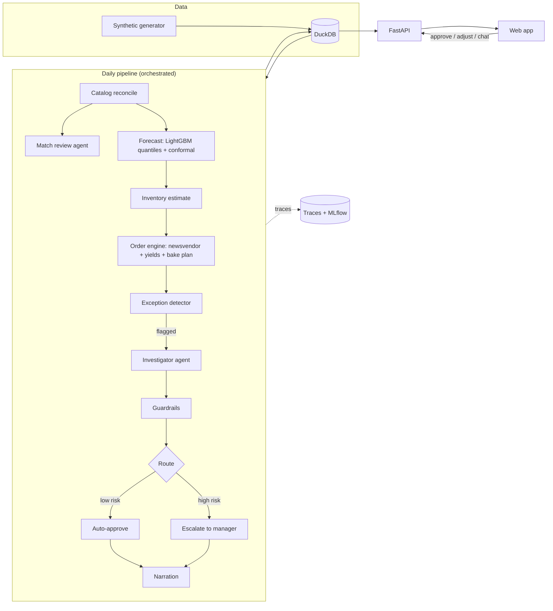

# FreshPilot — Business Requirements Document

**Agentic operations layer for fresh-grocery ordering**
Version 1.0 · Author: Naga Sai Anirudh Nori · Status: Approved for build

> FreshPilot is an independent proof of concept built on fully synthetic data. It is not affiliated with, and uses no data, code or branding from, any retailer or grocery software company.

---

## 1. Purpose

FreshPilot demonstrates how an agentic AI layer can run the daily ordering loop for fresh grocery departments: machine learning forecasts demand as a range, deterministic math decides every order, and LLM agents investigate exceptions, explain decisions in plain language, and escalate only what a human must decide.

The POC is built to be shown to grocery-AI leadership (CEO, VP Engineering, Head of AI) in a two-minute demo and a public repository. It must look like a real product, run end to end on a laptop, and prove its claims with measured numbers.

### 1.1 The one-line pitch

> **ML forecasts the range. Math decides the order. Agents explain and escalate.**

### 1.2 Problems addressed

| # | Problem in fresh grocery | How FreshPilot addresses it |
|---|---|---|
| P1 | Messy item data: the same product appears under several supplier listings, names and units, which splits demand history | Catalog reconciliation with calibrated match scores; an agent reviews only uncertain matches |
| P2 | Phantom inventory: spoilage, theft and miscounts go unrecorded, so the system believes stock exists and never reorders | Statistical detection of impossible sales patterns; estimated on-hand replaces book inventory |
| P3 | Point forecasts hide risk; perishables need the cost of waste weighed against the cost of an empty shelf per item | Quantile forecasts with calibrated intervals feeding a newsvendor optimizer |
| P4 | Ordered items transform into other items (whole chicken → thighs, breasts, wings) with different demand | Yield-aware ordering that backs demand out to the purchased item |
| P5 | Managers spend 1–2 hours a day reviewing every order | Routine items auto-approve; only a handful of exceptions reach a human, each with evidence |

---

## 2. Goals and success criteria

| ID | Goal | Measured by | Target |
|---|---|---|---|
| G1 | Better forecasts than a simple rule | WAPE vs seasonal-naive baseline on held-out weeks | ≥ 25% relative improvement |
| G2 | Honest uncertainty | Empirical coverage of the 80% interval | 78%–85% |
| G3 | Catch phantom inventory | Recall / precision on planted phantom events | ≥ 0.90 / ≥ 0.80 |
| G4 | Clean catalog | Pairwise match F1 on planted duplicates | ≥ 0.93 |
| G5 | Less waste, fewer stockouts | Backtest vs baseline ordering policy | Waste ↓ and stockouts ↓ simultaneously |
| G6 | Few human touches | Items escalated per day | ≤ 1% of items |
| G7 | Trustworthy agents | Numeric faithfulness of every explanation | 100% (enforced by guardrail) |
| G8 | Low LLM footprint | Share of items the LLM touches; LLM cost per daily run | ≤ 2%; ≤ $1.00 |
| G9 | Easy to run | `make demo` on a clean laptop | ≤ 10 minutes, no API key required |

Every number shown in the UI must come from these measurements. **No metric in the UI may be hardcoded.**

---

## 3. Scope

### 3.1 In scope

- Synthetic data generator with a ground-truth answer key
- Catalog reconciliation and match review agent
- Quantile demand forecasting, conformal calibration and SHAP explanations
- Inventory estimation and phantom-stock detection
- Newsvendor ordering engine with case-pack rounding and yield (transformation) handling
- Bakery production plan (bake quantities)
- Exception detection, investigator agent, guardrails, routing, narration
- "Ask FreshPilot" conversational assistant over read-only tools
- REST API and a web app matching the UI reference
- Observability (traces, pipeline runs, model health) and an evaluation harness
- Backtest comparing FreshPilot to a baseline ordering policy

### 3.2 Out of scope

- Real retailer data, integrations with POS/ERP systems, authentication and multi-tenant security
- Distribution-center buying, labor scheduling, pricing optimization
- Production deployment, high availability, horizontal scaling

---

## 4. Users and personas

| Persona | Needs | Primary screens |
|---|---|---|
| **Store / department manager** ("Maria Reyes") | Finish ordering fast; trust the system; only see what needs her | Today, Decisions, Orders, Ask FreshPilot |
| **Executive / CEO** | Proof of business value and safety at a glance | Today, Impact, Agent review |
| **ML / platform engineer** | See how it works, debug, verify quality and cost | Decisions → "See the math", Agent review, Observability |

---

## 5. Architectural principles (non-negotiable)

1. **LLMs plan and narrate; deterministic code computes and decides.** No order quantity, forecast, probability or metric is ever generated by an LLM.
2. **Every number has provenance.** Each quantity shown carries the ID of the engine call that produced it (`calc_id`).
3. **Agents can only read or simulate.** Agent tools are read-only or call the engine in simulation mode. No tool writes an order.
4. **Guardrails sit between the agent and the world.** Policy bands, unit compatibility and numeric-faithfulness checks run on every agent output.
5. **Humans decide what matters.** Items above a risk threshold are escalated; every human action is logged and fed back.
6. **Works without an API key.** A deterministic fallback produces templated explanations so the full demo runs offline.
7. **Reproducible.** A single seed drives data generation, training and backtests.

---

## 6. System architecture

### 6.1 Layers

| Layer | Responsibility | Key technology |
|---|---|---|
| Presentation | Web app (8 screens), chat drawer | React 18, Vite, TypeScript |
| API | REST endpoints for all screens and actions | FastAPI, Pydantic v2 |
| Agent layer | Investigator, catalog match review, narration, chat assistant | LangGraph, Anthropic Claude (tool use) |
| Guardrails | Policy validation, faithfulness check, approval gate | Python |
| Decision engine | Inventory estimate, newsvendor, yields, bake plan, exception rules | Python, NumPy, SciPy |
| ML layer | Quantile forecasts, calibration, explanations, entity matching | LightGBM, MAPIE, SHAP, sentence-transformers, rapidfuzz, pint, scikit-learn |
| Data layer | Synthetic data, feature store, results | DuckDB, Parquet |
| Observability & evals | Traces, pipeline runs, model tracking, eval reports | Langfuse (optional), MLflow, pytest |

### 6.2 Component diagram



### 6.3 Daily pipeline stages

| # | Stage | Executor | Output table |
|---|---|---|---|
| 1 | Ingest | Rules | raw tables validated |
| 2 | Catalog reconcile | Rules + ML | `match_candidates`, `product_listing_map` |
| 3 | Catalog match review | LLM agent | `match_reviews` |
| 4 | Demand forecast | ML | `forecasts` |
| 5 | Conformal calibration | ML | `forecasts` (calibrated columns) |
| 6 | Inventory estimate | Rules + stats | `inventory_estimates` |
| 7 | Order engine | Math | `orders` (status `proposed`) |
| 8 | Exception checks | Rules + stats | `exceptions` |
| 9 | Investigator agent | LLM agent | `findings` |
| 10 | Guardrail validation | Rules | `guardrail_events` |
| 11 | Routing | Rules | `orders.status`, `decisions` |
| 12 | Narration + publish | LLM + verifier | `decisions.explanation`, `item_reasons` |

Each stage writes a row to `pipeline_runs` / `pipeline_stages` with start time, duration, executor type (`rules`, `ml`, `llm`), counts and status.

---

## 7. Technology stack

| Area | Choice | Notes |
|---|---|---|
| Language | Python 3.11+ | `uv` for environment and lockfile |
| Data | DuckDB 1.x, Parquet, pandas 2.x | Single file `data/freshpilot.duckdb` |
| Forecasting | LightGBM (quantile objective) | One model per quantile |
| Calibration | MAPIE or hand-rolled split-conformal CQR | Time-based calibration split |
| Explanations | SHAP TreeExplainer | On the P50 model |
| Matching | rapidfuzz, sentence-transformers (`all-MiniLM-L6-v2`), pint, scikit-learn logistic regression | Embeddings cached to Parquet |
| Stats | SciPy | Poisson tail probabilities |
| Agents | LangGraph, `anthropic` SDK | Model from env `ANTHROPIC_MODEL` (default `claude-sonnet-5`) |
| API | FastAPI, Pydantic v2, uvicorn | OpenAPI docs at `/docs` |
| Frontend | React 18, Vite, TypeScript, plain CSS variables | Must match `docs/ui-reference.html` |
| Observability | Local trace store in DuckDB (always); Langfuse (optional, env-gated); MLflow file store | UI reads the local store |
| Testing | pytest, hypothesis (engine properties), Playwright (UI smoke) | |
| Quality | ruff, mypy (strict on `engine/` and `guardrails/`) | |

---

## 8. Synthetic data

### 8.1 Scale

| Entity | Count |
|---|---|
| Stores | 1 primary store (#318 "Riverside"); generator supports N |
| Departments | 5: Produce, Meat & Seafood, Bakery, Deli, Dairy & Eggs |
| Products | ≈ 1,280 (Produce ≈ 410, Meat ≈ 185, Bakery ≈ 95, Deli ≈ 240, Dairy ≈ 350) |
| Suppliers | 6 |
| Supplier listings | ≈ 2,340 (multiple listings per product, with noise) |
| History | 180 days of daily sales, receipts, waste, promotions and weather |

### 8.2 Data model (DuckDB)

| Table | Key columns |
|---|---|
| `stores` | store_id, name |
| `departments` | dept_id, name |
| `suppliers` | supplier_id, name, lead_time_days, delivery_days |
| `supplier_listings` | listing_id, supplier_id, raw_name, raw_unit, raw_pack, price |
| `products` | product_id, dept_id, name, sell_unit, case_pack, shelf_life_days, unit_cost, unit_price, salvage_value, is_random_weight |
| `product_listing_map` | listing_id, product_id, match_score, method (`auto`, `agent`, `human`) |
| `sales_daily` | date, store_id, product_id, qty_sold, price, on_promo |
| `receipts` | date, store_id, product_id, qty_received, lot_id |
| `waste_log` | date, store_id, product_id, qty_wasted, reason |
| `inventory_book` | date, store_id, product_id, book_on_hand |
| `promotions` | product_id, start_date, end_date, discount_pct, expected_lift |
| `weather` | date, temp_f, precip_prob, condition |
| `calendar` | date, dow, is_holiday, holiday_name |
| `yields` | parent_product_id, child_product_id, yield_per_parent |
| `bake_plans` | date, product_id, planned_qty |

### 8.3 Demand process

Daily demand per product = base rate × day-of-week effect × seasonality × promotion lift × weather effect (category-specific: berries and salads rise with heat, bread falls with rain) × holiday effect × Negative Binomial noise. Sales = min(demand, available on-shelf stock), so stockouts censor sales, as in real life.

### 8.4 Planted problems and answer key

The generator writes every planted problem to `answer_key` with `type`, `product_id`, `start_date`, `end_date` and ground-truth values.

| Type | How it is planted | Approx. count |
|---|---|---|
| `duplicate_listing` | Same product listed by 2–3 suppliers with abbreviated names, different units ("CS/12 5LB", "ea", "lb") | ≈ 450 products |
| `unit_mixup` | Listing unit inconsistent with price or pack | ≈ 20 |
| `hard_negative` | Similar names that are different products (hearts vs whole heads, bagged vs loose) | ≈ 40 pairs |
| `phantom_stock` | Book inventory stays positive while real shelf is empty (unrecorded spoilage or theft); sales drop to zero | ≈ 12 events in test window |
| `shrink_spike` | One lot spoils 2–4× faster than normal | ≈ 6 events |
| `yield_item` | Whole bird → thighs, breasts, wings with promo on one cut | ≥ 1 |
| `weather_event` | Rain or heat days that move category demand | several |

---

## 9. Functional requirements

Requirement IDs are referenced by tests. "Must" = required for v1; "Should" = include if time allows.

### 9.1 Catalog reconciliation (CAT)

| ID | Requirement |
|---|---|
| CAT-1 | Must parse raw units and packs into a canonical unit using regex + pint ("CS/12 5LB" → 60 lb; "12CT" → 12 ea). |
| CAT-2 | Must block candidate pairs by department and first token or embedding neighbourhood to avoid O(n²) comparisons. |
| CAT-3 | Must compute features per pair: token-set ratio, embedding cosine, unit compatibility, pack ratio, price ratio. |
| CAT-4 | Must turn features into a calibrated match probability with logistic regression trained on a labelled split of the answer key. |
| CAT-5 | Must auto-merge pairs with p ≥ 0.90, auto-separate p < 0.60, and send 0.60 ≤ p < 0.90 to the match review agent. |
| CAT-6 | The match review agent must return `merge` or `keep_separate` with a reason; the unit-compatibility validator can veto a merge. |
| CAT-7 | Agent decisions go to the Catalog screen for human Accept/Reject; accepted decisions update `product_listing_map` with method `human`. |

### 9.2 Forecasting (FC)

| ID | Requirement |
|---|---|
| FC-1 | Must train one global LightGBM model per quantile q ∈ {0.10, 0.25, 0.50, 0.60, 0.70, 0.75, 0.85, 0.90} across all products. |
| FC-2 | Features: lags 1/7/14/28, rolling means 7/28, day of week, holiday, promo flag and discount, days to/since promo, price, temperature, precipitation, category, shelf life, random-weight flag. |
| FC-3 | Must use a time-based split: train / calibrate / test (last 28 days = test). Never a random split. |
| FC-4 | Must enforce non-crossing quantiles (sort per row). |
| FC-5 | Must apply conformalized quantile regression so the 80% interval achieves target coverage on the calibration split. |
| FC-6 | Must produce per-item SHAP values from the P50 model, grouped into human-readable drivers ("Promo starts Fri", "Weekend", "Rain Saturday"). |
| FC-7 | Must forecast the delivery-cycle horizon (days until the next delivery after this one) as well as daily values for charts. |
| FC-8 | Must log parameters, metrics and artefacts to MLflow. |

### 9.3 Inventory estimation (INV)

| ID | Requirement |
|---|---|
| INV-1 | Must estimate on-hand = book on-hand − expected unrecorded shrink, where expected shrink uses shelf life, lot age and historical waste rates. |
| INV-2 | Must compute P(zero sales for k consecutive days \| stock truly on shelf) from the Poisson distribution using the forecast daily mean. |
| INV-3 | If that probability < 0.001, the item is flagged `phantom_stock` and estimated on-hand is set to the lower of book and the expected residual. |

### 9.4 Ordering engine (ORD)

| ID | Requirement |
|---|---|
| ORD-1 | Critical ratio CR = Cu / (Cu + Co), with Cu = unit margin + goodwill penalty, Co = unit cost − salvage value + disposal cost, adjusted for expected spoilage over shelf life. |
| ORD-2 | Target = the cycle-demand quantile at CR, interpolated from the calibrated quantiles. |
| ORD-3 | Order = max(0, target − estimated on-hand − on-order), rounded up to case pack; clipped to min/max order rules. |
| ORD-4 | Yield items: parent order covers max over children of (child demand target ÷ yield per parent); surplus children are reported with a disposition ("hot case", "markdown"). |
| ORD-5 | Bakery: produce a bake quantity per day using the same newsvendor logic with same-day shelf life. |
| ORD-6 | Every engine call must return a `calc_id` and a full breakdown (inputs, CR, target, on-hand used, rounding) stored in `calculations`. |
| ORD-7 | Engine must expose `simulate_order(product_id, overrides)` used by agents, which never writes an order. |
| ORD-8 | Property tests: order is monotonic in target and on-hand, never negative, always a multiple of case pack. |

### 9.5 Exception detection (EXC)

| ID | Requirement |
|---|---|
| EXC-1 | Flag `phantom_stock` (INV-3). |
| EXC-2 | Flag `shrink_spike` when waste rate over 7 days > 2.5× the trailing 28-day rate. |
| EXC-3 | Flag `order_swing` when the order differs from the trailing 4-week average by > 60% and no known driver explains it. |
| EXC-4 | Flag `low_confidence_match` when the item's history includes a merge with p < 0.80. |
| EXC-5 | Flag `yield_plan_change` and `bake_plan_change` when the plan deviates from usual by > 15%. |
| EXC-6 | Every item that passes all checks gets an `item_reasons` row with a one-line, template-generated reason and its category: `normal`, `adjusted`, `no_order`, `data_fix`. |

### 9.6 Agents (AGT)

**Investigator agent** (LangGraph state machine)

```
triage (rules) → investigate (LLM + tools) → validate (guardrails) → route (rules) → narrate (LLM + verifier)
```

| ID | Requirement |
|---|---|
| AGT-1 | Tools: `get_sales_history(product_id, days)`, `get_inventory(product_id)`, `get_forecast(product_id)`, `explain_forecast(product_id)`, `get_promotions(product_id)`, `get_weather(dates)`, `get_waste_log(product_id, days)`, `get_catalog_match(product_id)`, `simulate_order(product_id, overrides)`. All read-only. |
| AGT-2 | Output must validate against the `Finding` schema below; invalid output is retried once, then the item falls back to the templated path. |
| AGT-3 | Any recommended quantity must reference a `calc_id` returned by `simulate_order` in the same run. |
| AGT-4 | Max 8 tool calls and 30 s per item; on limit, escalate with the evidence gathered. |
| AGT-5 | Narration must produce a manager-facing explanation (≤ 60 words) plus 3 short reasons, in plain language without jargon. |
| AGT-6 | Fallback mode (no API key or `FRESHPILOT_LLM=off`): deterministic templates fill the same schema so the full UI works. |

```python
class Finding(BaseModel):
    product_id: str
    exception_type: Literal["phantom_stock","shrink_spike","order_swing",
                            "low_confidence_match","yield_plan_change","bake_plan_change"]
    summary: str                      # what was noticed, plain language
    evidence: list[Evidence]          # each with value, unit, source tool, source_ref
    recommended_action: Literal["approve","shelf_check_then_order","adjust","notify_supplier","review_match"]
    recommended_calc_id: str | None   # must come from simulate_order
    precondition: str | None          # e.g. "Do a shelf check first"
    risk_level: Literal["low","medium","high"]
    confidence: Literal["low","medium","high"]
    estimated_impact_usd: float | None  # computed by engine, not LLM
```

**Match review agent**: same pattern for CAT-5/6, schema `MatchReview(pair_id, decision, reason, evidence)`.

**Ask FreshPilot (chat)**

| ID | Requirement |
|---|---|
| AGT-7 | Conversational agent with the read-only tools above plus `list_decisions()`, `get_agent_activity(date)`, `get_impact_summary()`. |
| AGT-8 | Every answer must list the data sources used; answers containing numbers go through the faithfulness verifier. |
| AGT-9 | Refuses to change orders; points the user to the Approve/Adjust controls instead. |

### 9.7 Guardrails (GRD)

| ID | Requirement |
|---|---|
| GRD-1 | Quantity provenance: reject any recommendation whose quantity lacks a valid `calc_id`. |
| GRD-2 | Policy band: recommended quantity must be within [0.5×, 1.6×] of the engine's base order, and ≤ max shelf capacity; otherwise block and re-run `simulate_order` or escalate. |
| GRD-3 | Numeric faithfulness: extract every number from narratives and reasons; each must match a value in the run's tool outputs (tolerance 0.5%) or be a derived value recorded in `calculations`. Failure → regenerate once, then fall back to template. |
| GRD-4 | Unit compatibility veto on catalog merges. |
| GRD-5 | Routing: escalate if risk is high, confidence is low, action is `shelf_check_then_order` or `notify_supplier`, or any guardrail fired; else auto-approve. |
| GRD-6 | Manager overrides outside [0.6×, 1.5×] of the recommendation require a reason and are marked "needs category manager approval". |
| GRD-7 | Every guardrail event is written to `guardrail_events` with type, before/after values and run ID. |

### 9.8 API (API)

| Method | Path | Purpose |
|---|---|---|
| GET | `/api/summary/today` | Hero counts, KPI tiles, agent status |
| GET | `/api/departments` | Department cards and order status |
| GET | `/api/activity?limit=` | Agent activity feed |
| GET | `/api/decisions` | Escalated decisions with explanation, reasons, math and chart data |
| POST | `/api/decisions/{id}/approve` | Approve recommendation |
| POST | `/api/decisions/{id}/adjust` | Body: `{cases, reason}`; applies GRD-6 |
| POST | `/api/decisions/{id}/undo` | Revert to pending |
| GET | `/api/items?type=&dept=&q=&page=` | Agent review list (all items) |
| GET | `/api/items/{product_id}` | Spot check: forecast, stock, order math, checks |
| GET | `/api/orders` | Orders by department |
| POST | `/api/orders/send` | Allowed only when no decisions are pending |
| GET | `/api/catalog/summary` · `/api/catalog/reviews` | Catalog tiles and unsure matches |
| POST | `/api/catalog/reviews/{id}` | Body: `{action: accept|reject}` |
| GET | `/api/impact` | Backtest results and department comparison |
| GET | `/api/obs/pipeline` · `/api/obs/traces` · `/api/obs/traces/{run_id}` · `/api/obs/model` · `/api/obs/events` | Observability |
| POST | `/api/chat` | Chat turn; streams tokens (SSE) |
| POST | `/api/pipeline/run` | Re-run the daily pipeline for a date |

### 9.9 Web app (UI)

The UI must reproduce `docs/ui-reference.html` in layout, typography, colour and interaction, with all data coming from the API. Screens:

| Screen | Must show |
|---|---|
| **Today** | Hero ("reviewed N items, handled M on their own, K need your call"), 3 agent status rows, 4 KPI tiles, department cards, weekly waste-cost chart with go-live marker, live activity feed |
| **Decisions** | Cards with plain-language summary, 3 reasons, recommendation in cases, precondition, impact, confidence; Approve / Adjust (stepper with GRD-6 feedback) / Ask why; "See the math" panel with daily sales + forecast band chart, SHAP drivers, evidence, order math (P10/P50/P90, target quantile, on-hand system vs estimated, engine order, recommended); progress bar; undo |
| **Agent review** | Type cards (All, Needs you, Adjusted, Usual order, No order needed, Data fixed) with counts; search; department filter; paginated table; row spot-check with forecast, stock, order math and passed/failed checks |
| **Orders** | Department table with items, auto-approved, value, status; row click opens Agent review filtered to that department; "Send all orders" gated on pending decisions |
| **Catalog** | Tiles (listings, products, auto-fixed, need review); unsure matches with confidence, recommendation, reason, Accept/Reject |
| **Impact** | Waste reduction, food saved (lb and meals), margin, emissions; waste rate by department before/after; methodology note |
| **Observability** | Pipeline Gantt by executor type; items the LLM touched; LLM cost; guardrail count; trace table with expandable step timeline; model health (WAPE trend vs baseline, coverage vs target, feature drift PSI); guardrail and human-feedback events |
| **Ask FreshPilot** | Right-side drawer, suggested questions, streamed answers with sources |

UI rules: light and dark mode; responsive down to 375 px; keyboard accessible; charts have hover tooltips and text alternatives; plain language on manager screens, technical detail behind "See the math" and in Observability.

### 9.10 Observability (OBS)

| ID | Requirement |
|---|---|
| OBS-1 | Every agent run stores a trace: run_id, agent, product, steps (type, name, input summary, output summary, duration), tokens in/out, cost, outcome. |
| OBS-2 | Traces are always written to DuckDB; if `LANGFUSE_*` env vars are set they are also sent to Langfuse. |
| OBS-3 | `pipeline_stages` records executor type so the UI can show rules vs ML vs LLM time. |
| OBS-4 | Model health: WAPE by week vs baseline, interval coverage, PSI drift per feature group against the training window. |
| OBS-5 | Cost cap: abort LLM calls for the run if estimated cost exceeds `FRESHPILOT_MAX_RUN_USD` (default 1.00) and fall back to templates. |

### 9.11 Evaluation and backtest (EVAL)

| ID | Requirement |
|---|---|
| EVAL-1 | `make eval` computes G1–G8 against the answer key and writes `reports/eval.json` and `reports/eval.md`. |
| EVAL-2 | Backtest simulates 28 days of daily ordering with FreshPilot and with the baseline policy (order = last week's same-day sales − book on-hand), using true demand and true shelf stock, and reports waste %, stockout %, lost sales $, margin. |
| EVAL-3 | Agent evals: routing accuracy against the answer key; numeric faithfulness; schema validity; average tool calls and cost per run. |
| EVAL-4 | Impact screen and Observability model-health panel read from eval outputs. |
| EVAL-5 | CI (GitHub Actions) runs unit tests, a small-scale pipeline and evals in fallback mode on every push. |

---

## 10. Non-functional requirements

| ID | Requirement |
|---|---|
| NFR-1 | Full daily pipeline for ≈1,280 items completes in ≤ 5 min on a laptop (excluding first-time model download). |
| NFR-2 | Deterministic with `SEED` (default 42); identical outputs across runs in fallback mode. |
| NFR-3 | Secrets only via `.env`; `.env.example` committed; no secrets in logs or traces. |
| NFR-4 | API p95 latency < 300 ms for read endpoints. |
| NFR-5 | Test coverage ≥ 80% on `engine/`, `guardrails/`, `catalog/`. |
| NFR-6 | README states clearly: synthetic data, independent project, no affiliation. |
| NFR-7 | MIT license. |

---

## 11. Repository layout

```
freshpilot/
├── BRD.md                 # this document
├── CLAUDE.md              # build instructions for Claude Code
├── README.md
├── Makefile               # setup, data, train, pipeline, eval, api, web, demo, test
├── pyproject.toml
├── .env.example
├── docs/
│   ├── ui-reference.html  # visual and interaction target
│   └── architecture.md
├── freshpilot/
│   ├── config.py
│   ├── data/              # generator, schema, answer key
│   ├── catalog/           # units, blocking, features, matcher, match_review_agent
│   ├── forecasting/       # features, train, calibrate, explain, predict
│   ├── engine/            # inventory, newsvendor, yields, bakery, simulate
│   ├── exceptions/        # detectors, item_reasons
│   ├── agents/            # graph, tools, prompts, schemas, narrator, chat, fallback
│   ├── guardrails/        # provenance, policy_band, faithfulness, routing
│   ├── pipeline/          # orchestrator, stage logging
│   ├── obs/               # trace store, langfuse adapter, drift
│   ├── evals/             # metrics, backtest, reports
│   └── api/               # FastAPI app and routers
├── web/                   # React + Vite + TypeScript app
├── tests/
└── reports/               # generated eval outputs (gitignored except samples)
```

---

## 12. Build milestones

Each milestone ends with its acceptance check passing before the next starts.

| # | Milestone | Acceptance check |
|---|---|---|
| M0 | Repo scaffold, tooling, Makefile, CI skeleton | `make test` passes on empty suite; lint clean |
| M1 | Synthetic generator + DuckDB schema + answer key | Row counts within ±5% of §8.1; answer key has all types in §8.4; seeded reproducibility test |
| M2 | Catalog reconciliation (rules + ML) | Match F1 ≥ 0.93 on test split; unit-parser tests pass |
| M3 | Forecasting: quantiles, calibration, SHAP, MLflow | WAPE beats baseline ≥ 25%; coverage 78–85%; non-crossing test |
| M4 | Engine: inventory estimate, newsvendor, yields, bakery, simulate | Property tests (ORD-8); phantom recall ≥ 0.90 |
| M5 | Exceptions + item reasons + backtest | Waste and stockouts both below baseline; ≤ 1% escalated |
| M6 | Agents + guardrails (with fallback) | Schema validity 100%; faithfulness 100%; routing accuracy ≥ 0.90; runs with and without API key |
| M7 | Pipeline orchestrator + observability store | `make pipeline` completes ≤ 5 min; traces and stage timings populated |
| M8 | FastAPI endpoints | Contract tests for every endpoint in §9.8 |
| M9 | Web app matching UI reference | Playwright smoke: approve all decisions → send orders; visual review against reference |
| M10 | Chat assistant, polish, README, demo script | `make demo` from clean clone ≤ 10 min; README with results table from `reports/eval.md` |

---

## 13. Demo script (2 minutes)

1. **Today (20 s):** "Agents reviewed 1,2xx items this morning, handled almost all of them, and 5 need Maria." Show KPI tiles and the live feed.
2. **Decisions (40 s):** Open strawberries. Plain explanation → "See the math": sales dropped to zero, Poisson test, forecast range, target quantile, 48 lb. Approve.
3. **Agent review (20 s):** "What happened to the other 1,2xx?" Filter to Adjusted, spot-check one item.
4. **Observability (25 s):** The LLM touched under 1% of items; trace shows the guardrail blocking an out-of-band quantity.
5. **Impact (15 s):** Waste and stockouts vs baseline from the backtest. Close on the pitch line.

---

## 14. Risks and mitigations

| Risk | Mitigation |
|---|---|
| Synthetic data too easy, results look fake | Censored sales, noise, hard negatives, realistic effects; report baseline honestly |
| LLM unavailable or slow during demo | Fallback templates; cached last run; recorded Loom as backup |
| Metrics drift from UI claims | UI reads only from eval outputs (EVAL-4) |
| Scope creep | Milestones gate work; "Should" items only after M10 |
| Perceived as copying a company's product | Neutral name and design, independent-project notice, synthetic data only |

---

## 15. Glossary

| Term | Meaning |
|---|---|
| Book inventory | What the system believes is on hand (received − sold − recorded waste) |
| Phantom inventory | Stock the system believes exists but is not sellable |
| Quantile (P10, P50, P90) | Values below which 10%, 50%, 90% of outcomes are expected |
| Conformal calibration | Adjusts intervals so stated coverage matches observed coverage |
| Newsvendor | Chooses the order quantile that balances the cost of running out against the cost of waste |
| Case pack | Units per supplier case; orders are whole cases |
| Yield | Sellable child items produced from one parent item |
| SHAP | Per-prediction feature contributions used to explain forecasts |
| WAPE | Weighted absolute percentage error, Σ\|actual − forecast\| / Σ actual |
| PSI | Population stability index, a drift measure |
