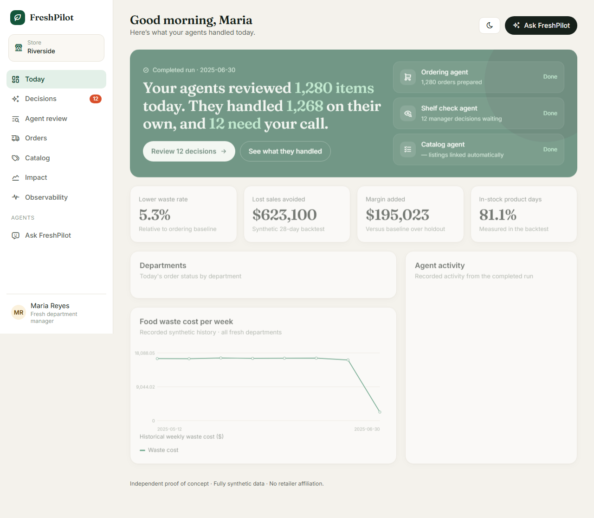
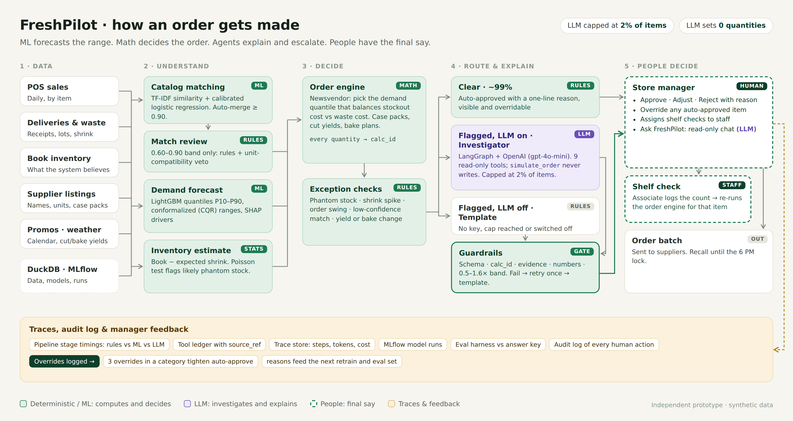
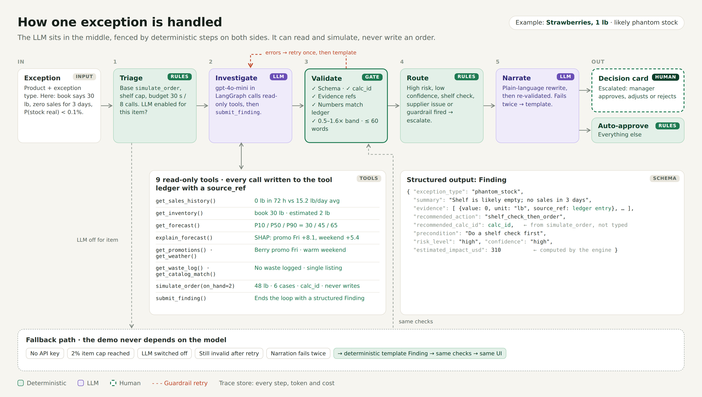

# FreshPilot

> FreshPilot is an independent proof of concept built on fully synthetic data. It is not affiliated with, and uses no data, code or branding from, any retailer or grocery software company.

**ML forecasts the range. Math decides the order. Agents explain and escalate.**

FreshPilot is an agentic operations layer for fresh-grocery ordering: machine learning forecasts demand as a range, deterministic math decides every order, and LLM agents investigate exceptions, explain decisions in plain language, and escalate only what a human must decide. See [`BRD.md`](BRD.md) for the full business requirements and [`docs/progress.md`](docs/progress.md) for build status.



## Architecture

### How an order gets made


Every quantity comes from the deterministic order engine (a newsvendor calculation on calibrated
LightGBM quantile forecasts) and carries a `calc_id`. About 99% of items pass every exception check
and are auto-approved with a reason. Flagged items go to a LangGraph investigator (OpenAI
gpt-4o-mini, capped at 2% of items), or to a deterministic template when the LLM is off, and both
pass the same guardrails before a manager decides.

### How one exception is handled


Triage, validation and routing are plain Python. The LLM can only call 9 read-only tools, where
`simulate_order` computes a quantity but never writes an order, and every call is recorded in a
tool ledger with a `source_ref`. A finding that fails validation gets one retry with the error,
then falls back to a deterministic template that must pass the same checks; the strawberry values
are an illustrative example. [`docs/architecture.md`](docs/architecture.md) has the text version.

## Status

Core data, catalog matching, forecasting, ordering, exceptions, guarded agents,
the daily pipeline, API, and React screens are implemented.
**The corrected evaluation passes G1–G8 in fallback mode.** The full-data pipeline
completed in 58 seconds; the full suite passes 146 tests. The frontend production
build and Playwright's approve → send → trace flow pass. A clean offline demo
build reached verified API and UI readiness in 124.7 seconds.
See [the correctness investigation](docs/correctness-review.md) for the repaired
calculation/guardrail behavior and the delivery assumptions. Live-provider smoke
checks exercised rejection and safe fallback; they are not a broad quality benchmark.

`make eval` writes measured results and exits unsuccessfully when a BRD goal fails.
Run `uv run python -m freshpilot.evals.diagnose` to compare delivery assumptions.
`FRESHPILOT_DEMO_DATE=YYYY-MM-DD` selects the exception/agent evaluation date;
leave it empty to use the latest forecast date. The date must have forecast data.

## Requirements

- Python 3.11+ ([uv](https://docs.astral.sh/uv/) manages the environment and lockfile)
- Node.js (for the web app, from M9 onward)
- GNU Make to run the `make` targets below. On Windows without Make on `PATH`, run the commands inside `Makefile` directly via `uv run ...`, or use WSL/Git Bash with Make installed.

## Run the demo

```bash
make setup
make demo
```

`make demo` regenerates the synthetic database, trains the models, runs the
pipeline and evaluation in offline fallback mode, builds the web app, then starts
the API on `:8000` and UI on `:5173`. Set `FRESHPILOT_DEMO_DATE=YYYY-MM-DD` to
select a forecast date; an empty value uses the latest available date.

On Windows without GNU Make, run `uv sync`, `cd web && npm install`, then from the
repository root run `uv run python -m freshpilot.demo`.

## Role-based workspace

Sign in using `admin@freshpilot.demo`, `manager@freshpilot.demo`, or
`staff@freshpilot.demo`. Each seeded local account uses `FreshPilot-demo!`.
The sign-in screen also has demo account shortcuts.

- **Admin:** store overview, exception approvals, team/store membership, ordering
  limits, catalog changes, audit history, and observability.
- **Manager:** store operations, shelf-check assignment, ordering and impact;
  catalog access is read-only.
- **Staff:** only their assigned shelf checks and task-scoped chat.

Managers assign a shelf check from **Shelf checks**. Staff submit total and damaged
quantities from **My tasks**; the deterministic engine recalculates the usable-stock
recommendation, which waits for manager review. Out-of-range adjustments are held
until an admin approves or rejects them with a reason. Pending checks and approvals
block sending. Named audit entries record changes, and modifying access revokes
that person's existing sessions.

Access is checked by the API as well as the interface. Accounts, memberships,
tasks, rules and audit history persist in DuckDB. Passwords are salted PBKDF2
hashes; sessions use HttpOnly cookies, expire after eight hours, and end on API
restart. POST requests require the `X-FreshPilot: 1` header.

This remains a **local, single-store proof of concept** with seeded credentials,
not a production identity service. Store memberships gate access to the existing
store dataset; the pipeline tables do not yet support independent multi-store
snapshots. Account creation does not send email, and chat cannot mutate orders.

To test against a database copy, set `FRESHPILOT_API_DB` to its absolute path before
starting the API. Run browser tests with `CI=1` to prevent reusing an existing server.

## Measured results

| Goal | Target | Result |
|---|---|---:|
| G1 Forecast WAPE improvement | ≥ 25% | 26.03% |
| G2 Calibrated 80% interval coverage | 78–85% | 79.18% |
| G3 Phantom-stock precision / recall | ≥ 80% / ≥ 90% | 100% / 91.67% |
| G4 Catalog match F1 | ≥ 0.93 | 0.9676 |
| G5 Waste rate, FreshPilot / baseline | below baseline | 6.15% / 6.50% |
| G5 Stockout rate, FreshPilot / baseline | below baseline | 18.92% / 61.46% |
| G6 Daily human escalations | ≤ 1% | 12 / 1,280 (0.94%) |
| G7 Narrative faithfulness | 100% | 100% (25 findings) |
| G8 LLM cost per run / items touched | ≤ $1.00 / ≤ 2% | $0.00 / 0% (fallback mode) |

G7 and G8 are measured in fallback mode; the live OpenAI path is not yet verified by the
eval. These are measurements on seeded synthetic data. See [the generated report](reports/eval.md)
and [architecture](docs/architecture.md) for methods and system boundaries.

## Commands

```bash
make setup       # uv sync, install web deps
make data        # generate synthetic data into data/freshpilot.duckdb
make train       # train forecasting and matching models (MLflow logs in mlruns/)
make pipeline    # run the daily pipeline for the demo date
make eval        # metrics + backtest -> reports/eval.json, reports/eval.md
make api         # FastAPI on :8000
make web         # Vite dev server on :5173
make demo        # data + train + pipeline + eval + api + web, one command
make test        # pytest (fallback mode) + ruff + mypy
```

`make test` and CI always run in fallback mode (`FRESHPILOT_LLM=off`, no `OPENAI_API_KEY` required) — the full system must work with no API key.

## Configuration

Copy `.env.example` to `.env`. Every variable is optional.

| Variable | Default | Purpose |
|---|---|---|
| `OPENAI_API_KEY` | empty | Enables the LLM investigator, narrator and chat; empty means fallback mode |
| `OPENAI_MODEL` | `gpt-4o-mini` | Only models with a verified price are accepted; others fall back |
| `FRESHPILOT_LLM` | `auto` | `auto` (on if a key is set), `on`, or `off` |
| `FRESHPILOT_MAX_RUN_USD` | `1.00` | Cost cap per pipeline run |
| `FRESHPILOT_DEMO_DATE` | latest forecast date | Pipeline date, `YYYY-MM-DD` |
| `FRESHPILOT_API_DB` | `data/freshpilot.duckdb` | Database the API reads |
| `SEED` | `42` | Seed for all randomness |

The BRD specifies Anthropic; this build uses OpenAI by explicit decision (see
[`docs/progress.md`](docs/progress.md), M6). The `LANGFUSE_*` variables are read but no
Langfuse export is wired yet; traces live in DuckDB.

## Project layout

```
freshpilot/
  data/         synthetic generator, DuckDB schema, answer key
  catalog/      unit parsing, TF-IDF blocking, calibrated match scores
  forecasting/  LightGBM quantile models, conformal calibration, SHAP
  engine/       inventory estimate, newsvendor, yields, bakery, simulate_order
  exceptions/   exception detectors and per-item reasons
  agents/       LangGraph investigator, tools, schemas, fallback template
  guardrails/   provenance, policy band, faithfulness, unit veto, routing
  pipeline/     the 12-stage daily run
  obs/          trace store and model health
  evals/        metrics, backtest, agent acceptance
  api/          FastAPI app, access control, shelf-check workflow
web/            React + Vite manager workspace
```

## License

MIT
