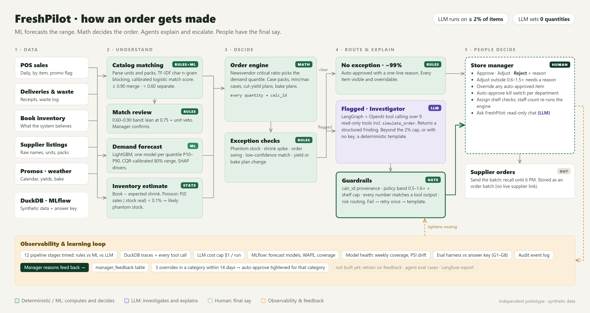
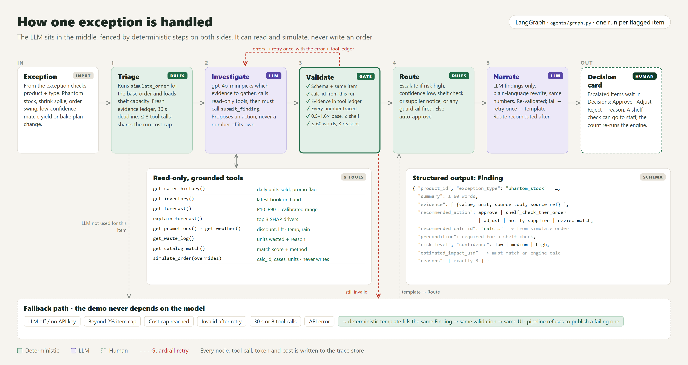

# FreshPilot architecture

```mermaid
flowchart LR
  S[Synthetic store history] --> C[Catalog reconciliation]
  C --> F[Quantile forecasting + calibration]
  F --> I[Inventory estimation]
  I --> E[Newsvendor, bakery and yield engine]
  E --> X[Exception rules]
  X --> A[Investigator or deterministic fallback]
  A --> G[Provenance, unit, policy and faithfulness guardrails]
  G --> R[Routing and manager decisions]
  R --> D[(DuckDB completed-run snapshot + traces)]
  D --> API[FastAPI]
  API --> UI[React manager workspace]
```

Diagram sources: `docs/diagrams/*.html` (rendered at 1.6x with Playwright).

The model forecasts a range. Deterministic code computes every quantity and
calculation ID. Agents can read evidence and simulate an order, but cannot write
one. Guardrails validate their output before routing. The API exposes only the
latest completed pipeline snapshot, so a failed rerun cannot leak partial state.

All demo data is synthetic. DuckDB stores source history, decisions and local
traces. MLflow stores model runs and artifacts. OpenAI is optional; fallback mode
uses the same schemas and guardrails and is the default demo path.
